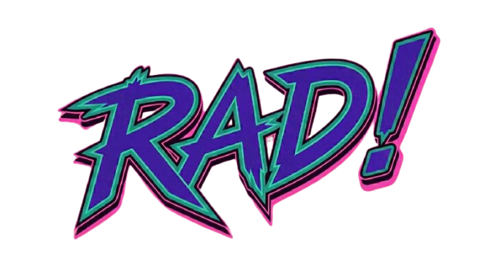

# RAD: Research, Architect, Deliver



A hybrid agent framework for small teams. Enforces information boundary
architecture, GSD-style wave execution, and event-recorded approval gates.

Built for teams of any size — works with a dedicated architect or with a
developer playing both roles on smaller projects.

Under the hood, RAD is a **deterministic harness** (the `rad` CLI in `harness/`,
which folds an append-only event log into gate decisions) wrapped in a **framework
shell** of slash commands and agent boundaries. The harness owns authority and
state; the shell owns ergonomics. See `docs/harness-and-framework.md`.

---

## How It Works

```
                    ── Gate 0 (optional) ──
                    /rad-epic-decompose [epic #] (architect)
                    Shapes a GitHub epic into per-child stories
                    Writes .agents/epics/ — no plans, no commit

ARCHITECT / TEAM                   TEAM
────────────────                   ────
/rad-research [prd or issue]       /rad-plan [feature]
  Consume spec artifact              Explore sub-agent researches codebase
  Clarify team + platform            Returns bounded RESEARCH_SUMMARY
  Write .agents/research/[slug]      Generate + lint plan file
                                     Cut rad/[feature] work branch
/rad-design [slug]                   Commit plan to that branch (no PR)
  Read research artifact
  Draft agent hierarchy            /rad-adopt [issue or description]
  Write .agents/architecture/        Same as /rad-plan, sourced from
  [architect reviews + approves]     a pre-existing issue or description
  Write .rad/agents/ sources
  rad generate → .claude/agents/,
    .codex/agents/

                    ── Gate 1 ──
                    /rad-approve (architect)
                    Reviews plan, records an `approved` event in
                    the feature's event log on the rad/[feature]
                    branch tip and pushes it. No PR — approval
                    lives in the event log on the branch

                                   /rad-deliver [feature]
                                     Runs `rad deliver`, which:
                                     Gates on the approved event (`rad gate`)
                                     Merges the default branch into rad/[feature]
                                     Each wave → one call to the `agent:`
                                     Retries + stops live in the harness
                                     Records the run in the event log
                                     Opens the single deliver PR

                    ── Gate 2 ──
                    Architect reviews the deliver PR
                    (rad/[feature] → default branch)
                    Plan doc + code land together
                    Standard code review, then merge
```

---

## One Branch, One PR

Every feature lives on a single `rad/[feature]` work branch, cradle to grave.
`/rad-plan` cuts it from the default branch and commits the plan doc to it.
`/rad-approve` records an `approved` event in the feature's event log
(`.agents/state/<feature>/events.jsonl`) on that branch's tip — that event is the
gate authority. `/rad-deliver` runs on the same branch and opens the one deliver
PR. The plan doc and the code reach the default branch together through that
single reviewed PR, which keeps contributors off the protected default branch.
There is no plan PR.

The default branch is whatever you set as `default_branch:` in `.rad/config.yml`
(resolved by `scripts/get-default-branch.sh`; see `docs/configuration.md`) — it
is never hardcoded.

## Two Gates

**Gate 1 — Plan approval** (architect runs `/rad-approve`)
- One file: `.agents/plans/[feature].md` on the `rad/[feature]` branch
- Architect reviews the *approach* before code is written
- `/rad-approve` records an `approved` event in the feature's event log on the
  branch tip and pushes that branch — no PR, no merge to the default branch. (It
  also mirrors `Status: approved` into the plan doc, but that header is display
  only — the event is the authority.)
- Blocked: `/rad-deliver` gates on the approved event via `rad gate <feature>
  approved` at the branch tip

**Gate 2 — Deliver PR** (`rad/[feature]` → default branch)
- Plan doc and all implementation changes, together
- Architect reviews the *output* after execution
- Standard code review workflow, then merge

---

## Token Efficiency

RAD delegates heavy context work to sub-agents so main sessions stay lean:

| Phase | What runs in a sub-agent | What stays in main context |
|-------|--------------------------|---------------------------|
| `/rad-research` URL input | Haiku sub-agent: fetches and summarizes spec URL | Bounded `SPEC_SUMMARY` block |
| `/rad-design` file generation | Parallel Haiku sub-agents: one per agent file | Completion confirmations |
| `/rad-plan` research | Explore sub-agent: searches codebase, returns `RESEARCH_SUMMARY` | The summary block (~20 lines) |
| `/rad-deliver` per wave | `rad deliver` runs one configured-agent call per wave (e.g. `claude -p`): loads files, implements, validates, commits | The command's exit code and result lines |
| `/rad-review` | quality-reviewer + accessibility-reviewer agents | Finding summaries |

The plan linter enforces a **context budget** on the Files in Scope table:
- **Warn** at >800 lines in scope — consider splitting
- **Error** at >1500 lines — must split before the plan can be approved

---

## Role Structure

| Role | Commands | Responsibility |
|------|----------|----------------|
| Architect | All commands (incl. `/rad-design`, `/rad-approve`, `/rad-epic-decompose`) | Defines agent boundaries, decomposes epics, approves plans, merges PRs |
| Developer | `/rad-research`, `/rad-plan`, `/rad-adopt`, `/rad-deliver`, `/rad-review` | Research, plan, and execute within boundaries |
| Designer | `/rad-research`, `/rad-plan`, `/rad-adopt`, `/rad-deliver` | UI-scoped research, planning, and execution |
| All roles | `/rad-status`, `/rad-insights`, `/kickoff`, `/wrap` | Team dashboard, review pattern analysis, session start/end rituals |

All commands are committed to the project repo. The `architect/` subdirectory
signals which commands carry architect-level responsibility — enforcement is via
the PR workflow, not command access control. Branch protection on your default
branch is recommended; see [INSTALL.md](INSTALL.md#3-set-up-branch-protection-recommended).

---

## Installation

```bash
git clone https://github.com/seanrreid/RAD_framework /tmp/rad
bash /tmp/rad/install.sh --dir /path/to/your-project
```

The installer handles directory structure, commands, scripts, and the
`AGENTS.md` and `CLAUDE.md` scaffolding in one step. See [INSTALL.md](INSTALL.md) for the full guide
including upgrade and uninstall instructions.

**Prerequisites:** `git`, `node`, and an agent CLI of your choice (or an
`ANTHROPIC_API_KEY` for the `sdk` adapter) to run `/rad-deliver`. `claude` and
`codex` are built-in presets. `gh` or `glab` is recommended for PR automation.

### Choose your agent

`rad deliver` runs each wave through the agent you configure, and it need not be
Claude. Use `install.sh --agent claude|codex`, or
`rad config init --agent-cmd "<cmd>"` for any other CLI. See
[Choose your agent](INSTALL.md#choose-your-agent) in INSTALL.md and
[Agent Adapter](docs/configuration.md#agent-adapter) for the adapters,
authentication and precedence rules.

---

## File Structure After Installation

```
your-project/
├── AGENTS.md                         ← project conventions (the conventions source)
├── CLAUDE.md                         ← imports AGENTS.md + Claude Code specifics
├── .rad/
│   ├── config.yml                    ← platform, roles, agent, scope map
│   ├── installed.json                ← install manifest: framework files + hashes
│   ├── agents/                       ← agent sources (built-in reviewers; /rad-design adds yours)
│   └── skills/                       ← skill sources; `rad generate` writes the per-agent copies
├── .claude/
│   ├── commands/                     ← architect/, team/, shared/ slash commands
│   ├── skills/                       ← kickoff, wrap
│   ├── agents/                       ← generated agent files, incl. the built-in reviewers
│   └── settings.json                 ← registers the deliver-gate hook
├── .codex/
│   └── agents/                       ← generated Codex agent files
├── .agents/
│   ├── research/                     ← research artifacts (/rad-research output)
│   ├── architecture/                 ← architecture drafts (/rad-design draft → approved)
│   ├── plans/                        ← plan artifacts (Gate 1)
│   ├── logs/                         ← optional execution logs (nothing gates on them)
│   ├── findings.jsonl                ← append-only review findings log (written by /rad-review)
│   ├── findings/README.md            ← findings log schema and query reference
│   ├── skills/                       ← generated skill copies for Codex
│   ├── state/<feature>/events.jsonl  ← append-only event log, the gate authority (created at runtime)
│   ├── epics/                        ← epic shaping stories (created at runtime)
│   └── playbooks/                    ← pinned playbooks (created at runtime)
├── ai/                               ← guardrail pack
├── harness/                          ← `rad` CLI (harness/cli.js)
└── scripts/                          ← helper scripts (platform detection, check-*, lint-*, PR
                                         creation, …), plus lib/ and hooks/
```

---

## Docs

| Doc | Read when |
|-----|-----------|
| `INSTALL.md` | Installing or uninstalling RAD |
| `UPGRADE.md` | Upgrading an existing RAD project to the latest version |
| `docs/how-it-works.md` | The whole process explained — model, lifecycle, guardrails |
| `docs/harness-and-framework.md` | What RAD *is* — the harness core vs. the framework shell, grounded in code |
| `docs/rad-cli.md` | The `rad` CLI — gates, deliver, agent adapters, worktree/budget/hook config |
| `docs/rad-wave-contract.md` | The provider-neutral wave-execution contract adapters honor |
| `docs/harness-state-store.md` | The deterministic event-log StateStore at the harness core |
| `docs/framing-decisions.md` | How RAD positions itself on hooks, loops, context injection, and agent-to-agent orchestration |
| `docs/references.md` | Annotated log of external sources reviewed against RAD, the takeaways, and issues they generated |
| `docs/daily-workflow.md` | Getting started with the team workflow |
| `docs/architect-guide.md` | Setting up and maintaining the architecture |
| `docs/epic-decomposition.md` | When, why, and how to run the Gate-0 `/rad-epic-decompose` step |
| `docs/plan-approval-guide.md` | How plan approval works and what to review |
| `docs/wave-execution.md` | How /rad-deliver runs tasks in waves |
| `docs/platform-support.md` | Git platform configuration and fallbacks |
| `docs/onboarding.md` | Guide for new team members |
| `docs/apply-to-existing.md` | Applying RAD to an existing project (2–3 weeks) |
| `docs/maintaining-claude-md.md` | Maintaining AGENTS.md and CLAUDE.md: keeping conventions accurate over time |
| `docs/acp-evaluation.md` | Why RAD speaks the Agent Client Protocol at the provider seam, and what it costs |
| `docs/agent-hierarchy-audit.md` | Why each of the internal agents exists, tagged by the boundary it enforces |
| `docs/agentic-factory-checks/` | The agentic-factory-checks audit: the checks, indexes and sources RAD was compared against |
| `docs/configuration.md` | The `.rad/config.yml` schema, `rad config`, every `RAD_*` variable, and approval and branch rules |
| `docs/evals.md` | How the scripted and live evals check that RAD's guards hold when an agent misbehaves |
| `docs/invariants.md` | The invariant registry: every safety guarantee RAD claims and where it is enforced |
| `docs/playbooks.md` | Pinned playbooks for recurring change shapes and the `--playbook` flag |
| `docs/rad-decisions.md` | RAD's own rationale, testing standards and constraints, with pointers to the source of truth |
| `docs/rad-tool-portability.md` | How RAD's Claude Code surface maps to Codex CLI via `rad generate` |
| `docs/research/` | Outside comparisons and reading notes (WSD, Flue, Cosmos, CASE, harness engineering, 12-Factor Agents); background, not guidance |
| `.agents/findings/README.md` | Findings log schema, record types, and jq query reference |

---

## Credits

- Dex Horthy — [Advanced Context Engineering](https://youtu.be/rmvDxxNubIg) and [12-Factor Agents](https://www.youtube.com/watch?v=8kMaTybvDUw)
- Cole Medin — [PIV loop pattern](https://github.com/coleam00/habit-tracker)
- GSD Framework — [wave execution model](https://github.com/gsd-build/get-shit-done)

---

## License

RAD is open source under the [MIT License](./LICENSE). Use it, fork it, build on
it — commercially or otherwise. The only requirement is that the copyright notice
and license text travel with substantial copies.
